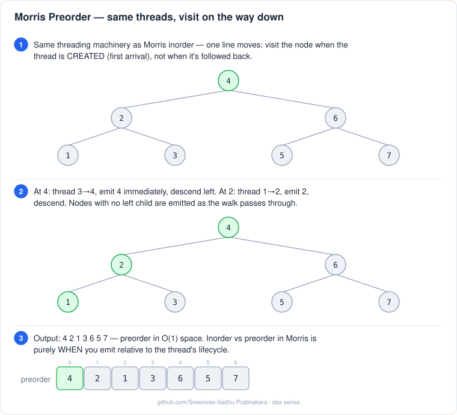

# Morris Preorder Traversal

> Striver SDE Sheet 108 · Day 17 Binary Tree — identical threading to Morris inorder; only the visit moves from thread-removal to thread-creation. Go, stdlib only, tested.

## Problem

Preorder traversal in O(1) auxiliary space — no recursion, no stack.

## Approach

Diff against Morris inorder (#107) and exactly one line moves: the visit. Inorder visits a node when returning to it through the thread (left subtree complete); preorder visits it when *first* arriving and creating the thread — root before left subtree, which is the definition of preorder. Everything else (predecessor hunt, thread creation, unthreading on return) is byte-for-byte the same machinery. Seeing the pair side by side is the real lesson: traversal order is just *where you put the emit* relative to the same walk.

**Complexity:** O(n) time, O(1) space.

## Visual walkthrough

Read the picture top to bottom — each numbered frame is one moment of the algorithm
running on this repo's test example.

## Run

    go test ./...   # verify
    go run .        # demo

---

One of 191 repos solving Striver's SDE Sheet in Go — stdlib only, one problem per repo, every solution tested. Browse the set: [`dsa-*` repos](https://github.com/Sreenivas-Sadhu-Prabhakara?tab=repositories&q=dsa-&type=source).
